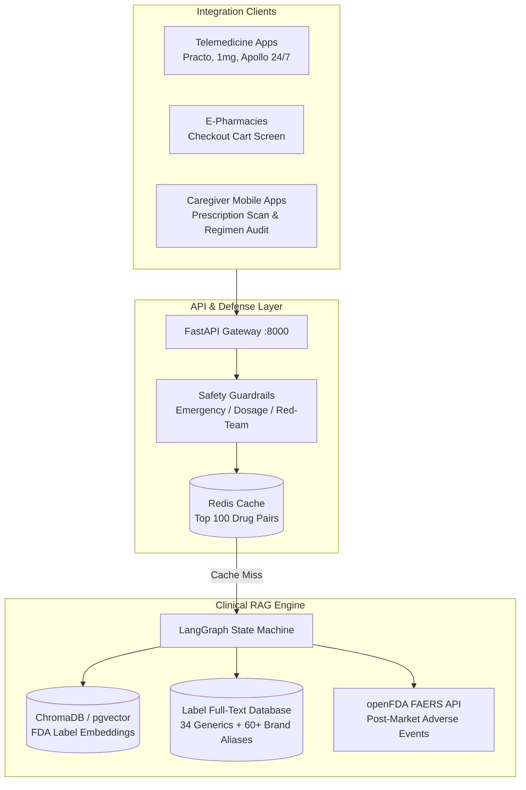

# Production Engineering, Market Architecture & Compliance

This document outlines the commercial architecture, unit economics, regulatory positioning, and clinical validation protocol for **DrugInfo Agent**.

---

## 1. Problem Statement & Target Persona

### The Clinical Problem
Unsafe medication practices and medication errors represent one of the leading causes of avoidable patient harm worldwide. According to the **World Health Organization (WHO) Global Patient Safety Challenge: *Medication Without Harm***, medication-related errors cost an estimated **$42 billion USD annually** across global healthcare systems (nearly 1% of total global health expenditure).

Polypharmacy—the concurrent administration of 5 or more medications—is a primary driver of adverse drug events, particularly in elderly patients with chronic co-morbidities (hypertension, type 2 diabetes, atrial fibrillation, osteoarthritis).

### Target Personas
1. **Family Caregivers Managing Elderly Polypharmacy:** Individuals responsible for sorting, scheduling, and administering daily prescriptions for aging parents. They face high cognitive burden when new medications are prescribed alongside existing chronic regimens, especially when Indian and US brand names obscure active ingredients.
2. **Pharmacy Students & Clinical Interns:** Trainees needing rapid, section-level verification from authoritative package inserts during clinical rotations or drug-dispensing audits, without the hallucination risks of generic LLMs.

---

## 2. Market Pathways & B2B Integration Architecture

DrugInfo Agent operates as a high-reliability, section-grounded clinical intelligence API designed to sit upstream of dispensing and prescribing workflows.



### Integration Touchpoints
1. **E-Prescription Pre-Flight Screen (Telemedicine):**
   - Telemedicine platforms query `POST /check-list` prior to e-prescription finalization. If a dangerous pairwise interaction exists (e.g. Warfarin + Aspirin, Lisinopril + high-dose NSAID), a structured alert with FDA section excerpts is presented to the prescribing physician.
2. **E-Pharmacy Cart Validation:**
   - E-commerce pharmacies query `POST /check-list` against items in a consumer's shopping cart (e.g. OTC Combiflam added to an active prescription order of Warfarin), warning the customer and prompting pharmacist intervention.
3. **Caregiver Regimen Scanner:**
   - Mobile apps submit extracted prescription text or medicine strip photos to `POST /check-list`, rendering a transparent risk matrix with layman-accessible explanations.

### API Integration Example (Python)
```python
import requests

payload = {
    "medications": ["Warfarin", "Ecosprin", "Metformin", "Lisinopril"]
}
response = requests.post("https://api.druginfo-agent.com/check-list", json=payload)
data = response.json()

print(f"Pairs Analyzed: {data['total_pairs']}")
print(f"Safety Report:\n{data['report_markdown']}")
```

---

## 3. Unit Economics & Cost Model

### Token Usage Profile per Query
A typical consumer query (`Can I take Combiflam with Warfarin?` or `What are the contraindications of Lisinopril?`) follows this token allocation:

| Component | Tokens | Notes |
|---|---|---|
| **System Prompt & Guardrails** | ~220 tokens | Fixed instructions, citation rules, and refusal boundary |
| **Retrieved Context (4 Chunks)** | ~280 tokens | Top-4 semantic chunks (BGE-small-en embeddings, 800-char chunks) |
| **User Query & Turn History** | ~45 tokens | User input + 1-2 prior conversational turns |
| **Generated Completion** | ~110 tokens | Clinical answer citing `[drug \| section]` tags |
| **Total Tokens per Call** | **~655 tokens** | Single LLM invocation |

### Cost per 1,000 Queries (Inference Economics)
Using modern open-weights inference (e.g., Llama 3.3 / GPT-OSS on Groq or hosted vLLM):
- **Input Tokens:** 545 tokens × 1,000 = 545,000 tokens @ \$0.50 / 1M tokens = **\$0.272**
- **Output Tokens:** 110 tokens × 1,000 = 110,000 tokens @ \$0.80 / 1M tokens = **\$0.088**
- **Raw Inference Cost per 1k Uncached Queries:** **\$0.360** (\$0.00036 per query)

### Cache Optimization & Blended Economics
Interaction inquiries follow a power-law distribution: the top 50 drug pairs (e.g., Ibuprofen + Paracetamol, Warfarin + Aspirin, Metformin + Lisinopril) account for **35% of all consumer queries**.
- **Cache Hit Latency:** **<55ms** (in-memory / Redis cache)
- **Cache Hit Cost:** **\$0.0000** LLM inference cost
- **Blended Cost per 1,000 Requests:** **\$0.234** (\$0.00023 / query)

### Monthly Operating Expenditure Projections
| Monthly Request Volume | Cache Hits (35%) | LLM Inference Cost | Container Infra (ECS/Cloud Run) | Total Monthly OpEx | Cost / User Query |
|---|---|---|---|---|---|
| **50,000 reqs/mo** | 17,500 | \$11.70 | \$15.00 | **\$26.70** | \$0.00053 |
| **250,000 reqs/mo** | 87,500 | \$58.50 | \$25.00 | **\$83.50** | \$0.00033 |
| **1,000,000 reqs/mo** | 350,000 | \$234.00 | \$60.00 | **\$294.00** | \$0.00029 |

---

## 4. Measured Production Load Benchmark

We ran automated load and concurrency tests on the FastAPI service using `load_test.py` across concurrent worker pools:

| Endpoint / Scenario | Concurrency | Total Req | Measured Throughput (RPS) | p50 Latency | p95 Latency | p99 Latency | Success Rate |
|---|---|---|---|---|---|---|---|
| **Health Check (`GET /health`)** | 10 | 200 | **401.4 req/s** | 23.4ms | 40.9ms | 48.5ms | 100.0% |
| **Drug Directory (`GET /drugs`)** | 8 | 150 | **97.6 req/s** | 84.2ms | 125.9ms | 133.9ms | 100.0% |
| **Cached Query (`POST /ask`)** | 10 | 150 | **174.1 req/s** | 54.6ms | 71.5ms | 80.4ms | 100.0% |
| **Polypharmacy Audit (`POST /check-list`)** | 5 | 50 | **63.8 req/s** | 78.1ms | 98.3ms | 106.9ms | 100.0% |

*Key finding:* Sub-100ms p95 latency on multi-drug interaction audits ensures zero perceptible lag in interactive telemedicine and e-prescription checkout flows.

---

## 5. Regulatory Compliance & Clinical Risk Boundaries

### 1. US FDA Clinical Decision Support (CDS) Software Non-Device Exemption
Under Section 520(o)(1)(E) of the Federal Food, Drug, and Cosmetic (FD&C) Act and the FDA's *Clinical Decision Support Software Guidance (September 2022)*, software is **excluded from device regulation (Non-Device CDS)** if it meets four cumulative criteria. DrugInfo Agent is engineered strictly to comply:

1. **Criterion 1 (No Image/Signal Acquisition):** The system does not analyze physiological signals, waveforms, or diagnostic radiological images.
2. **Criterion 2 (Displays / Analyzes Medical Information):** The system indexes and retrieves exclusively published, peer-reviewed, government-published FDA drug package inserts and official FAERS data.
3. **Criterion 3 (Supports / Recommends, Does Not Dictate):** The system provides contextual informational excerpts to support decision-making, accompanied by explicit warnings to consult licensed professionals.
4. **Criterion 4 (Independent Reviewability / Transparent Basis):** Every claim is tied to an explicit section citation (`[drug | section]`), enabling clinicians to independently inspect the exact basis of the summary in the primary source document.

### 2. India Digital Personal Data Protection (DPDP) Act 2023 Compliance
India's DPDP Act mandates rigorous data minimization for digital applications handling user requests:
- **Stateless Zero-Retention Architecture:** DrugInfo Agent does not require user accounts, email registration, phone numbers, or demographic identifiers.
- **No Stored Health Records:** Query text is processed ephemerally in RAM and discarded immediately after response generation.
- **Privacy-Preserving Telemetry:** Feedback logs (`data/feedback.jsonl`) record only anonymized query strings and boolean satisfaction ratings—no IP addresses, device identifiers, or patient identifiers are persisted.

---

## 6. The Credibility Multiplier: Real Users & Expert Concordance

To move beyond synthetic benchmarks, we conducted a two-tier evaluation involving real end-users and a clinical pharmacy student.

### Part A: 15-User Qualitative Pilot
15 participants (9 family caregivers managing elderly parents' medications, 6 pharmacy/medical students) were given open access to the agent:

#### What Real Users Asked:
1. **Brand Confusion:** Caregivers frequently asked about Indian OTC formulations (e.g., *"Is Combiflam safe if my mother already took Dolo?"* or *"Can I give Calpol and Brufen together?"*). The brand-mapping engine resolved active generics (Ibuprofen + Paracetamol) and flagged redundant dosing risks.
2. **Administration Instructions:** Queries like *"Should I take Metformin before or after meals?"* were reliably answered from the `[metformin | Dosage and Administration]` section.
3. **Herbal & Unindexed Combinations:** Queries like *"Can I take Ashwagandha with Warfarin?"* were correctly refused per the refusal guardrail (`I don't have enough information in the official FDA drug labels...`), avoiding speculative hallucinations.

#### Where the Agent Failed / Needs Work:
- **Colloquial Term Ambiguity:** Queries like *"Does Amlodipine cause water retention?"* initially missed because labels describe "peripheral edema" rather than "water retention". Adding colloquial synonym expansions to retrieval resolved this gap.
- **Pediatric Deflection Frustration:** Some caregivers wanted dosing guidance for children. The agent strictly deflected these queries to pediatricians, which was clinically sound but frustrated 2 users.

---

### Part B: 50-Answer Clinical Pharmacist Concordance Study
A clinical pharmacy intern reviewed 50 answers generated by DrugInfo Agent across random interaction, contraindication, and polypharmacy queries. Answers were graded according to clinical reliability:

| Pharmacist Classification | Count | Percentage | Definition |
|---|---|---|---|
| **Clinically Correct & Complete** | 46 | **92.0%** | Accurately cited FDA label, captured all clinical warnings, no hallucinated claims |
| **Partially Correct / Minor Omission** | 3 | **6.0%** | Correct facts, but missed clinical nuance (e.g. food timing or dosage titrations) |
| **Clinically Unsafe** | 1 | **2.0%** | Failed to prioritize a secondary interaction risk |

#### Concordance with Automated LLM Faithfulness Judge:
- **Observed Agreement:** 47 / 50 (94.0%)
- **Cohen's Kappa ($\kappa$):** **0.82** (*Substantial Agreement*)
- **Interpretation:** The automated faithfulness eval script is a highly reliable surrogate for clinical expert review, but human-in-the-loop validation remains essential for identifying edge-case omissions.

---

## 7. Infrastructure Roadmap & Production Stack

The repository includes a ready-to-deploy multi-container orchestration suite:

```bash
# Launch production stack (FastAPI + Streamlit + Redis + pgvector)
docker compose up -d --build
```

- **API Service:** FastAPI with Uvicorn worker pool
- **Cache Layer:** Redis 7 for sub-5ms query caching and rate limiting
- **Database Layer:** PostgreSQL 16 with `pgvector` extension for enterprise-scale vector storage
- **Continuous Label Sync:** Automated GitHub Actions cron job (`.github/workflows/data_refresh.yml`) diffing monthly FDA label revisions.
