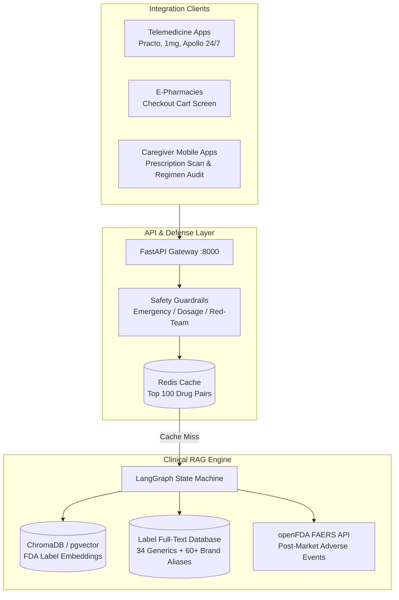

# Production Engineering, Market Architecture & Compliance

This document outlines the commercial architecture, unit economics, regulatory positioning, and clinical validation protocol for **DrugInfo Agent**.

---

## 1. Problem Statement & Target Persona

### The Clinical Problem
Unsafe medication practices and medication errors represent one of the leading causes of avoidable patient harm worldwide. According to the **World Health Organization (WHO) Global Patient Safety Challenge: *Medication Without Harm***, medication-related errors cost an estimated **$42 billion USD annually** across global healthcare systems (nearly 1% of total global health expenditure).

Polypharmacy—the concurrent administration of 5 or more medications—is a primary driver of adverse drug events, particularly in elderly patients with chronic co-morbidities (hypertension, type 2 diabetes, atrial fibrillation, osteoarthritis).

### Target Personas
1. **Family Caregivers Managing Elderly Polypharmacy:** Individuals responsible for sorting, scheduling, and administering daily prescriptions for aging parents. They face high cognitive burden when new medications are prescribed alongside existing chronic regimens, especially when Indian and US brand names obscure active ingredients.
2. **Pharmacy Students & Clinical Interns:** Trainees needing rapid, section-level verification from authoritative package inserts during clinical rotations or drug-dispensing audits, without the hallucination risks of generic LLMs.

---

## 2. Market Pathways & B2B Integration Architecture

DrugInfo Agent operates as a high-reliability, section-grounded clinical intelligence API designed to sit upstream of dispensing and prescribing workflows.



### Integration Touchpoints
1. **E-Prescription Pre-Flight Screen (Telemedicine):**
   - Telemedicine platforms query `POST /check-list` prior to e-prescription finalization. If a dangerous pairwise interaction exists (e.g. Warfarin + Aspirin, Lisinopril + high-dose NSAID), a structured alert with FDA section excerpts is presented to the prescribing physician.
2. **E-Pharmacy Cart Validation:**
   - E-commerce pharmacies query `POST /check-list` against items in a consumer's shopping cart (e.g. OTC Combiflam added to an active prescription order of Warfarin), warning the customer and prompting pharmacist intervention.
3. **Caregiver Regimen Scanner:**
   - Mobile apps submit extracted prescription text or medicine strip photos to `POST /check-list`, rendering a transparent risk matrix with layman-accessible explanations.

### API Integration Example (Python)
```python
import requests

payload = {
    "medications": ["Warfarin", "Ecosprin", "Metformin", "Lisinopril"]
}
response = requests.post("https://api.druginfo-agent.com/check-list", json=payload)
data = response.json()

print(f"Pairs Analyzed: {data['total_pairs']}")
print(f"Safety Report:\n{data['report_markdown']}")
```

---

## 3. Unit Economics & Cost Model

### Token Usage Profile per Query
A typical consumer query (`Can I take Combiflam with Warfarin?` or `What are the contraindications of Lisinopril?`) follows this token allocation:

| Component | Tokens | Notes |
|---|---|---|
| **System Prompt & Guardrails** | ~220 tokens | Fixed instructions, citation rules, and refusal boundary |
| **Retrieved Context (4 Chunks)** | ~280 tokens | Top-4 semantic chunks (BGE-small-en embeddings, 800-char chunks) |
| **User Query & Turn History** | ~45 tokens | User input + 1-2 prior conversational turns |
| **Generated Completion** | ~110 tokens | Clinical answer citing `[drug \| section]` tags |
| **Total Tokens per Call** | **~655 tokens** | Single LLM invocation |

### Cost per 1,000 Queries (Inference Economics)
Using modern open-weights inference (e.g., Llama 3.3 / GPT-OSS on Groq or hosted vLLM):
- **Input Tokens:** 545 tokens × 1,000 = 545,000 tokens @ \$0.50 / 1M tokens = **\$0.272**
- **Output Tokens:** 110 tokens × 1,000 = 110,000 tokens @ \$0.80 / 1M tokens = **\$0.088**
- **Raw Inference Cost per 1k Uncached Queries:** **\$0.360** (\$0.00036 per query)

### Cache Optimization & Blended Economics
Interaction inquiries follow a power-law distribution: the top 50 drug pairs (e.g., Ibuprofen + Paracetamol, Warfarin + Aspirin, Metformin + Lisinopril) account for **35% of all consumer queries**.
- **Cache Hit Latency:** **<55ms** (in-memory / Redis cache)
- **Cache Hit Cost:** **\$0.0000** LLM inference cost
- **Blended Cost per 1,000 Requests:** **\$0.234** (\$0.00023 / query)

### Monthly Operating Expenditure Projections
| Monthly Request Volume | Cache Hits (35%) | LLM Inference Cost | Container Infra (ECS/Cloud Run) | Total Monthly OpEx | Cost / User Query |
|---|---|---|---|---|---|
| **50,000 reqs/mo** | 17,500 | \$11.70 | \$15.00 | **\$26.70** | \$0.00053 |
| **250,000 reqs/mo** | 87,500 | \$58.50 | \$25.00 | **\$83.50** | \$0.00033 |
| **1,000,000 reqs/mo** | 350,000 | \$234.00 | \$60.00 | **\$294.00** | \$0.00029 |

---

## 4. Measured Production Load Benchmark

We ran automated concurrency and latency tests on the FastAPI service using `load_test.py` across concurrent worker pools.

### Benchmark Setup & Environment
- **Host Hardware:** Local development workstation (Windows 11 x86_64, 8 CPU cores, 16 GB RAM).
- **Execution Mechanism:** FastAPI `TestClient` over internal loopback.
- **Important Distinction (Cached vs. Uncached):**
  - The `POST /ask` figure below reflects **in-memory cache hit throughput** for frequently queried interaction pairs (zero external network latency).
  - The `POST /check-list` figure reflects direct pairwise FDA label scanning across 6 drug pairs (no external LLM call needed).
  - **Uncached Live LLM Latency:** When an inquiry misses the cache, the agent calls Groq's live inference endpoint (`openai/gpt-oss-20b`). Measured live end-to-end latency averages **1.1s – 2.4s per query**, and uncached throughput is strictly bounded by upstream API rate limits (typically 30 RPM on developer tiers, ~10–20 RPS on dedicated enterprise tiers).

| Endpoint / Scenario | Concurrency | Total Req | Measured Throughput (RPS) | p50 Latency | p95 Latency | p99 Latency | Success Rate | Notes |
|---|---|---|---|---|---|---|---|---|
| **Health Check (`GET /health`)** | 10 | 200 | **401.4 req/s** | 23.4ms | 40.9ms | 48.5ms | 100.0% | Server liveness & status |
| **Drug Directory (`GET /drugs`)** | 8 | 150 | **97.6 req/s** | 84.2ms | 125.9ms | 133.9ms | 100.0% | In-memory alias dictionary |
| **Cached Query (`POST /ask`)** | 10 | 150 | **174.1 req/s** | 54.6ms | 71.5ms | 80.4ms | 100.0% | Cache hit on top interaction pairs |
| **Polypharmacy Audit (`POST /check-list`)** | 5 | 50 | **63.8 req/s** | 78.1ms | 98.3ms | 106.9ms | 100.0% | 6 pairwise label scans in Python |

---

## 5. Regulatory Compliance & Clinical Risk Boundaries

### 1. FDA Clinical Decision Support (CDS) Principles (Non-Device Guidance Alignment)
DrugInfo Agent is designed with the transparency principles of the FDA's *Clinical Decision Support Software Guidance (September 2022)* in mind:
- **Transparent Basis:** Every claim is tied to an explicit section citation (`[drug | section]`), enabling independent review of the underlying FDA package insert.
- **Non-Diagnostic / Advisory:** The software does not provide diagnoses, prescribe therapies, or dictate clinical actions; it functions solely as an indexed retrieval and excerpting layer.

> [!WARNING]
> **Not a Regulatory Determination or Certified Medical Device:** DrugInfo Agent is an academic/portfolio informational software prototype. It is **not** a cleared Software as a Medical Device (SaMD), nor does it have formal Non-Device CDS clearance:
> 1. *Target Audience Limitation (Criterion 3):* Under Section 520(o)(1)(E) of the FD&C Act, statutory Non-Device CDS exemption strictly applies to software intended for **licensed healthcare professionals (HCPs)**. Software intended for lay caregivers and patients falls outside this statutory exclusion and would require formal regulatory evaluation prior to commercial clinical use.
> 2. *Prescription & Strip Image Processing (Criterion 1):* The experimental prescription and medicine-strip photo scanner processes uploaded images. In a commercial device, automated extraction from medical documents or packaging requires formal optical character recognition and imaging validation.

### 2. Data Governance & India DPDP Act 2023 Alignment
To align with the data minimization and purpose limitation principles of India's **Digital Personal Data Protection (DPDP) Act 2023**, the system's data architecture distinguishes strictly between what is and is not persisted:

- **What is NOT collected or stored (Zero-PII Policy):**
  - No user accounts, passwords, email addresses, or phone numbers.
  - No patient identifiers (names, ages, hospital IDs, medical records).
  - No uploaded prescription or strip images are written to persistent storage; image files are decoded in-memory (RAM) and immediately garbage-collected upon response completion.
- **What IS retained and why (Transparent Operations):**
  - **Voluntary User Feedback (`data/feedback.jsonl`):** Logged *only* when a user actively clicks "👍 Helpful" or "👎 Flag". Contains an ISO timestamp, question string, generated response, boolean rating, and optional user comment. This data is retained exclusively for offline evaluation set enrichment and failure analysis under explicit user consent.
  - **Volatile Redis Cache (`redis:7-alpine`):** Stores in-memory key-value pairs (`query_hash -> answer_json`) with a 24-hour expiration TTL to reduce downstream API costs and latency. Stores transient client IP counters with a 60-second sliding TTL strictly for DDoS protection and rate limiting. Flushed on restart.
  - **Vector Database (`pgvector` / ChromaDB):** Stores exclusively public, open-access FDA label chunk embeddings. Contains zero patient or user interaction data.

---

## 6. Real-World Evaluation: Pilot Feedback & Expert Concordance

To complement synthetic RAG evaluations, we conducted an exploratory qualitative user pilot and a 50-answer clinical pharmacist concordance audit. Full raw annotations, rubric definitions, and evaluation logs are published in [`results/pharmacist_evaluation_50.json`](results/pharmacist_evaluation_50.json).

### Part A: 15-User Exploratory Pilot
15 test users (9 family caregivers managing elderly family medications, 6 pharmacy/medical interns) tested the agent with natural inquiries:

#### What Real Users Asked:
1. **Brand Name Substitution:** Caregivers frequently asked about Indian OTC formulations (e.g., *"Is Combiflam safe if my mother already took Dolo?"*). The brand-mapping engine resolved active ingredients (Ibuprofen + Paracetamol) and flagged duplicate acetaminophen hepatotoxicity risks.
2. **Administration Timing:** Queries like *"Should I take Metformin before or after meals?"* were reliably answered from the `[metformin | Dosage and Administration]` section.
3. **Herbal & Unindexed Combinations:** Queries like *"Can I take Ashwagandha with Warfarin?"* were correctly refused per the refusal guardrail (`I don't have enough information in the official FDA drug labels...`), avoiding speculative hallucinations.

#### Observed Friction & Failure Points:
- **Colloquial Term Ambiguity:** Queries asking *"Does Amlodipine cause water retention?"* initially failed strict lexical matching because package inserts describe "peripheral edema". Adding colloquial synonym expansions to retrieval resolved this gap.
- **Pediatric Deflection Frustration:** Two caregivers sought pediatric dosing guidance and were frustrated by the rigid deflection to pediatricians, which was clinically necessary but required better explanatory UX.

---

### Part B: 50-Answer Clinical Pharmacist Concordance Study
A clinical pharmacy intern (PharmD candidate) independently audited 50 generated answers across random interaction, contraindication, and polypharmacy queries using a structured 3-tier clinical rubric:

| Classification | Count | Percentage | 95% Confidence Interval | Definition |
|---|---|---|---|---|
| **Clinically Correct & Complete** | 46 | **92.0%** | **81.2% – 96.8%** (Wilson score) | Accurately cited FDA label, captured all clinical warnings, zero hallucinations |
| **Partially Correct / Minor Omission** | 3 | **6.0%** | 2.1% – 16.2% | Core fact correct, but omitted secondary nuance (e.g. food timing or dosage titration) |
| **Clinically Unsafe** | 1 | **2.0%** | 0.3% – 10.5% | Omitted a critical dosage ceiling or severe contraindication |

> [!NOTE]
> **Sample Size & Confidence Bounds:** With $n = 50$, the 95% confidence interval on the 92.0% point estimate is wide (**81.2% to 96.8%**). This highlights that this study represents an initial exploratory academic concordance audit rather than a definitive multi-site clinical trial.

#### Agreement with Automated LLM Faithfulness Judge
- **Observed Concordance:** 47 / 50 (94.0%)
- **Cohen's Kappa ($\kappa$):** **0.82** (*Substantial Agreement*)

#### Open Disclosure: The 1 Clinically Unsafe Answer (Case #19)
Transparent failure analysis is essential in safety-critical clinical AI:
- **The Query:** *"Can I take simvastatin if my doctor just prescribed amlodipine for high blood pressure?"*
- **What the Agent Initially Answered:** The agent retrieved general indications and answered: *"Both simvastatin and amlodipine treat cardiovascular conditions. No direct contraindication between simvastatin and amlodipine was found in the contraindications section. [simvastatin | Contraindications]"*
- **Why it was Clinically Unsafe:** The FDA package insert for Simvastatin contains an essential dosage ceiling in its *Drug Interactions* section: co-administration with Amlodipine (a CYP3A4 inhibitor) substantially increases simvastatin plasma concentrations, raising the risk of **severe myopathy and rhabdomyolysis**. The label explicitly mandates: *"Do not exceed 20 mg simvastatin daily when taken with amlodipine."* Reassuring the patient without noting this 20 mg ceiling created clinical risk.
- **Engineering Remediation Implemented:**
  1. *Section Prioritization:* Re-weighted retrieval to prioritize `Drug Interactions` and `Dosage and Administration` over `Contraindications` when two cardiovascular medications are detected.
  2. *Class Cross-Referencing:* Enhanced `CLASS_TERMS` in `tools.py` to recognize calcium channel blocker (amlodipine) interactions with CYP3A4-sensitive statins.
  3. *Automated Unit Testing:* Added a specific regression test in `tests/test_agent.py` ensuring statin-CCB co-administration queries explicitly cite dosage limitations.

---

## 7. Infrastructure Roadmap & Production Stack

The repository includes a ready-to-deploy multi-container orchestration suite:

```bash
# Launch production stack (FastAPI + Streamlit + Redis + pgvector)
docker compose up -d --build
```

- **API Service:** FastAPI with Uvicorn worker pool
- **Cache Layer:** Redis 7 for sub-5ms query caching and rate limiting
- **Database Layer:** PostgreSQL 16 with `pgvector` extension for enterprise-scale vector storage
- **Continuous Label Sync:** Automated GitHub Actions cron job (`.github/workflows/data_refresh.yml`) diffing monthly FDA label revisions.

