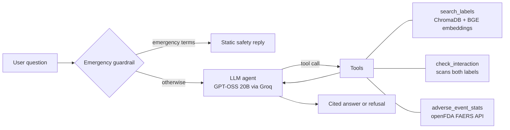

# 💊 DrugInfo Agent: agentic RAG over FDA drug labels

[](https://github.com/Tripathijii147/druginfo-agent/actions)

**Live demo:** https://druginfo-agent-nulmtmjne8khoa3zwcvbwn.streamlit.app/

A LangGraph agent that answers medicine questions **only from FDA label text**, cites the label section for every claim, and refuses when the labels don't answer. Not medical advice.

## Architecture



| Tool | What it does |
|---|---|
| `search_labels` | Semantic search over label sections (indications, dosage, contraindications, warnings, interactions, adverse reactions), with automatic per-drug filtering |
| `check_interaction` | Looks for the other drug (name, brand or drug class) inside each label's Drug Interactions section and returns the excerpt. "No mention" is reported as *not proof of safety* |
| `adverse_event_stats` | Live top reported reactions from the FDA FAERS database |

Design choices: structured citations `[drug | section]`, an exact refusal sentence for unanswerable questions, a rule-based emergency guardrail that runs *before* the LLM, retry and graceful failure on model errors, and a step limit on the agent loop.

## Evaluation

Three scripts, all reproducible (see `results/`):

```bash
python eval_retrieval.py       # retrieval hit-rate@k, with and without the drug filter
python eval_faithfulness.py    # LLM-judged faithfulness + refusal on unanswerable questions
python eval_agent.py           # tool routing, refusals, emergency guardrail
```

Results (copy from `results/*.md` after running):

- Retrieval hit-rate@4: **97%** (k=2: 90%, k=4: 97%, k=6: 100% on 30 questions)
- Faithfulness (LLM judge): **93%** (28/30) — source in top-4 chunks: 97% — unanswerable correctly refused: 4/4
- Agent routing / refusal / guardrail: **9/10 correct**

Offline unit tests (no API key, run in CI): `pytest tests -q`

## Run locally

```bash
python -m venv .venv && source .venv/bin/activate      # Windows: .venv\Scripts\activate
pip install -r requirements.txt
cp .env.example .env                                    # then put your GROQ_API_KEY in it
python build_index.py
streamlit run app.py
```

## Data and limitations

- Data: FDA labels from openFDA for 34 common drugs (`fetch_labels.py` re-downloads them). Each section is truncated to 6,000 characters, so a very long Drug Interactions section may be cut.
- `check_interaction` is keyword/class based, not a clinical interaction database. It will miss interactions the label doesn't spell out.
- Only the listed drugs are covered. This is a portfolio project, not a medical device.

## Stack

Python, LangChain, LangGraph, ChromaDB, sentence-transformers (BAAI/bge-small-en-v1.5), Groq (GPT-OSS 20B), Streamlit, openFDA, GitHub Actions, Streamlit Community Cloud.

