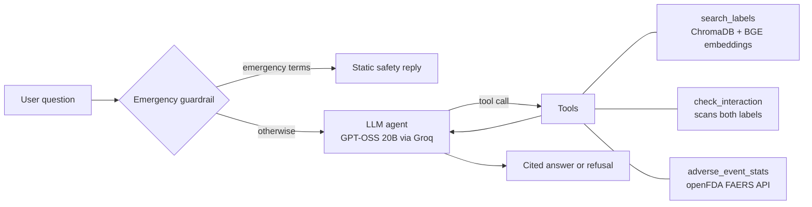

# 💊 DrugInfo Agent: agentic RAG over FDA drug labels

[](https://github.com/Tripathijii147/druginfo-agent/actions)

**Live demo:** https://druginfo-agent-nulmtmjne8khoa3zwcvbwn.streamlit.app/

A LangGraph agent that answers medicine questions **only from FDA label text**, cites the label section for every claim, and refuses when the labels don't answer. Not medical advice.

## Architecture



| Tool | What it does |
|---|---|
| `search_labels` | Semantic search over label sections (indications, dosage, contraindications, warnings, interactions, adverse reactions), with automatic per-drug filtering |
| `check_interaction` | Looks for the other drug (name, brand or drug class) inside each label's Drug Interactions section and returns the excerpt. "No mention" is reported as *not proof of safety* |
| `adverse_event_stats` | Live top reported reactions from the FDA FAERS database |

Design choices: structured citations `[drug | section]` with automated post-generation verification and correction against retrieved tool outputs, an exact refusal sentence for unanswerable questions, a rule-based emergency guardrail that runs *before* the LLM, retry and graceful failure on model errors, and a step limit on the agent loop.

## Evaluation

Three reproducible benchmark scripts evaluated on **30 hand-built ground-truth questions** and adversarial edge cases (see `results/`):

```bash
python eval_retrieval.py       # retrieval hit-rate@k, with and without the drug filter
python eval_faithfulness.py    # LLM-judged faithfulness + refusal on unanswerable questions
python eval_agent.py           # tool routing, refusals, emergency guardrail
```

Results across the benchmark:

- **Retrieval hit-rate@4**: **97%** (k=2: 90%, k=4: 97%, k=6: 100% on 30 hand-built questions)
- **Faithfulness (LLM judge)**: **93%** (28/30 on answerable questions; source chunk in top-4: 97%; unanswerable correctly refused: 4/4)
- **Agent tool routing & guardrails**: **90%** (9/10 correct routing on interaction check, label search, FAERS statistics, emergency triage, and off-domain deflection)

Offline unit tests (10 passing tests, no API key required, runs in GitHub Actions CI): `pytest tests -q`

## Known Failure Cases

Transparent failure analysis helps identify engineering tradeoffs:

1. **Routing Ambiguity on Side Effects vs. Real-world FAERS Statistics:**
   - *Query:* `"What are the common side effects of amlodipine?"`
   - *Failure:* The agent calls `adverse_event_stats` (spontaneous post-market reports) instead of `search_labels` (controlled clinical trial adverse reactions in the package insert).
   - *Cause:* Semantic overlap between "side effects" and "adverse event reports" in tool docstrings.

2. **Complex Multi-drug Interactions (> 2 drugs):**
   - *Query:* `"Can I take aspirin, clopidogrel, and omeprazole together?"`
   - *Failure:* `check_interaction` expects pairwise inputs `(drug_a, drug_b)`. The agent either chooses only one pair or attempts to pass multiple names into one argument.
   - *Mitigation in progress:* Expanding `check_interaction` into a combinatoric pair iterator or multi-agent graph node.

3. **Inferred vs. Explicit Contraindications:**
   - *Query:* `"Can a patient with severe kidney failure take metformin?"`
   - *Failure:* The label discusses eGFR thresholds (e.g. `< 30 mL/min/1.73 m²`), but colloquial queries asking about "kidney failure" can fail strict lexical matching if the prompt strictly penalizes clinical inference.


## Run locally

```bash
python -m venv .venv && source .venv/bin/activate      # Windows: .venv\Scripts\activate
pip install -r requirements.txt
cp .env.example .env                                    # then put your GROQ_API_KEY in it
python build_index.py
streamlit run app.py
```

## Data and limitations

- Data: FDA labels from openFDA for 34 common drugs (`fetch_labels.py` re-downloads them). Each section is truncated to 6,000 characters, so a very long Drug Interactions section may be cut.
- `check_interaction` is keyword/class based, not a clinical interaction database. It will miss interactions the label doesn't spell out.
- Only the listed drugs are covered. This is a portfolio project, not a medical device.

## Stack

Python, LangChain, LangGraph, ChromaDB, sentence-transformers (BAAI/bge-small-en-v1.5), Groq (GPT-OSS 20B), Streamlit, openFDA, GitHub Actions, Streamlit Community Cloud.

